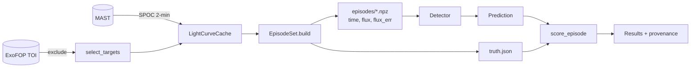

<p align="center">
  
</p>

<h1 align="center">Star Gazer</h1>

<p align="center">
  A verifiable benchmark and reinforcement-learning environment for finding exoplanets in light curves.<br>
  A language model works through a light curve with an astronomer's classical tools, and the benchmark scores its decision against an exact answer key.
</p>

<p align="center">
  <a href="#purpose">Purpose</a> ·
  <a href="#installation">Installation</a> ·
  <a href="#workflow">Workflow</a> ·
  <a href="#method">Method</a> ·
  <a href="#results">Results</a> ·
  <a href="#toolbox">Toolbox</a> ·
  <a href="https://stargazer-model.readthedocs.io/">Docs</a>
</p>

<p align="center">
  <a href="https://stargazer-model.readthedocs.io/"></a>
  
  
  
  
</p>

---

## Purpose

Mission pipelines search every star once with one fixed set of thresholds, so a signal
below the cut never reaches a human. Star Gazer tests a different way of
working. A language model receives one light curve together with the classical tools of
an astronomer, among them Box Least Squares (BLS), phase folding, an odd-even check and
a single-event search. The model calls the tools it needs, in the order it chooses, and
decides whether the star has a transiting planet and at what period and epoch. The
benchmark then scores that decision against an answer key that is exact, because the
planets were put there on purpose.

The answer key comes from injection and recovery, the method the Kepler and TESS teams
use to measure their own pipelines. The build step takes real Transiting Exoplanet
Survey Satellite (TESS) light curves of stars with no detected planet and multiplies
synthetic transits with known parameters into some of them. Each episode therefore has
a known truth, the build configuration sets how faint and how long-period the
injections are, and a new episode set costs one command.

The same design makes every result reproducible by anyone with the repository. Each
random choice has a seed, each data file has a hash in a manifest, and each results
file records the git commit, the episode-set hash, the full detector configuration and
the score of every episode. The detector sees only time, flux and flux error, while the
truth lives in a separate file that only the scorer reads, so a detector cannot learn
the answers from its input.

## Installation

Clone the repository, create a virtual environment with uv and install the package
with its optional extras. The agent commands read provider keys from `.env`, which git
ignores, and the test suite runs without network access.

```bash
git clone git@github.com:siddharth7113/stargazer_model.git star_finder && cd star_finder
uv venv && uv pip install -e ".[dev,docs,tinker,view]"
cp .env.example .env            # add TINKER_API_KEY or OPENROUTER_API_KEY; git ignores .env
pytest                          # offline test suite, no network
```

## Workflow

<p align="center">
  
</p>

The commands below take one TESS sector from host-star selection to a comparison
table. The first three build an episode set, the next two run the classical baseline
and a language-model agent on it, and the last two inspect and compare the results.
The recording above comes from `assets/quickstart.tape`, which
[VHS](https://github.com/charmbracelet/vhs) replays, so it stays in step with the
commands.

```bash
stargazer targets  --sector 98 --n 60 --seed 1               # host stars with no TOI
stargazer fetch    --targets data/targets_s98.json           # cache light curves, write a manifest
stargazer build    --targets data/targets_s98.json --n 200 --seed 1 --out data/episodes/s98_v1
stargazer baseline --episodes data/episodes/s98_v1           # Box Least Squares floor
stargazer agent    --episodes data/episodes/s98_v1 --backend tinker \
                   --model Qwen/Qwen3.8-27B --renderer qwen3_8_disable_thinking --limit 3
stargazer view     --results results/<run>.json              # read the trajectories
stargazer compare  results/baseline_bls_s98_v1_sde7.json results/full/agent_*.json
```

## Method



A detector is any object with a `detect(time, flux, flux_err) -> Prediction` method,
so a new detection method plugs into the benchmark without changes to the benchmark
itself. Two detectors ship with the package. The first is the classical BLS baseline,
which sets the floor that any agent has to clear. The second is a tool-using agent that
drives any chat model through a single backend method, so the agent loop, the tools and
the prompt belong to Star Gazer and a model provider contributes only text completion.
The Tinker backend uses the Tinker cookbook renderers to prompt and parse each model
family in its native tool format, which lets Qwen, Nemotron and Inkling compete on
equal terms.

```python
from stargazer import BLSDetector, EpisodeSet, ToolAgentDetector, evaluate
from stargazer.backends import TinkerBackend

episodes = EpisodeSet("data/episodes/s98_v1")
baseline = evaluate(BLSDetector(sde_threshold=18.6), episodes, workers=8)
agent = evaluate(
    ToolAgentDetector(TinkerBackend("Qwen/Qwen3.8-27B", renderer="qwen3_8_disable_thinking")),
    episodes,
    workers=8,
)
agent.save("results/my_run.json")
```

## Trajectories

A score says how often a model is right, and a trajectory says how it got there. Star
Gazer saves one trajectory for each episode, with the model's thinking, each tool call
and its arguments, each tool result and the final answer. `stargazer view` opens them
in a terminal viewer with filters for hits, misses and false alarms, and
`stargazer show` prints one episode to the console.

<!-- viewer screenshot -->
<p align="center">
  
</p>

## Results

The table below is for episode set `s98_v1`: 200 episodes drawn from 39 stars in TESS
sector 98, each a 57-day light curve, with injected periods from 0.5 to 20 days, depths
from 100 ppm to 1 percent, and 29 percent of the episodes left without a planet.
Completeness is the fraction of injected planets recovered at the right period and
epoch, and the false-alarm rate is the fraction of planet-free episodes on which the
system claimed a detection.

| system | false alarm | completeness | mean score | tokens/episode |
|---|---|---|---|---|
| Box Least Squares, SDE threshold 13 | 7% | 39% | 0.545 | - |
| Box Least Squares, SDE threshold 11 | 28% | 41% | 0.502 | - |
| Inkling-Small, original tools | 19% | 40% | 0.522 | 21,000 |
| Qwen3.8-27B, original tools | 24% | 43% | 0.527 | 57,000 |

With the original toolbox the agents land level with the thresholded baseline. Their
wrong answers come from unrelated noise peaks on faint injections, which the tools
surfaced and the models had no way to reject, so the toolbox is the current ceiling
and model size matters less than the evidence a model can ask for. Runs with the
masked re-search and single-event tools are in progress, and LOGBOOK.md holds every
number with the command that produced it.

## Toolbox

| tool | what it does | status |
|---|---|---|
| `summarize` | cadence, noise level, flux range, gaps | done |
| `bls_peaks` | Box Least Squares; distinct peaks, alias periods, event counts, masks for rejected signals | done |
| `single_events` | strongest individual dips by the single-event statistic | done |
| `fold` | binned phase curve at a period and epoch | done |
| `odd_even` | per-event depth comparison with a verdict | done |
| iterative multi-signal search, transit-shape fit, duration consistency | detection | planned |
| secondary eclipse, ephemeris match, centroid motion, difference imaging, Gaia dilution | vetting | planned |
| vetting report, preregistered predictions | reporting | planned |

Each tool is a function of the three light-curve arrays, with a JSON Schema for the
model, a numpydoc Notes section that states its equation and its source, and a unit
test on synthetic data. The planned rows follow the order in which a human vetter
works: a deeper search first, then the checks that separate planets from eclipsing
binaries and systematics, then a report.

## Layout

```
stargazer/
  types.py       Prediction and the Detector protocol
  data.py        LightCurveCache: download and cache TESS 2-minute light curves
  targets.py     select_targets: host stars with no TOI, with TIC parameters
  inject.py      batman transit injection and the truth record
  episodes.py    EpisodeSet and BuildConfig
  score.py       scoring rules and set-level metrics
  evaluate.py    evaluate and Results, with a worker pool
  baseline.py    BLSDetector
  tools.py       analysis tools with JSON Schemas, one registry for every backend
  agent.py       ToolAgentDetector and the ChatBackend protocol
  backends.py    OpenAICompatibleBackend (OpenRouter, vLLM, Ollama) and TinkerBackend
  calibrate.py   threshold choice from recorded statistics
  compare.py     one table for several results files
  viewer.py      terminal trajectory viewer
  provenance.py  hashes, manifests, git commit
  cli.py         command line
tests/           one unit-test file for each module; tests/integration/ for cross-module checks
scripts/         pre-commit lint hooks
docs/            Sphinx documentation with Mermaid diagrams
```

## Documentation

The documentation lives on Read the Docs at <https://stargazer-model.readthedocs.io/>
and is rebuilt on each push to `main`. It covers the methodology, the architecture with
class, flow and sequence diagrams, the scoring rules, the verifiability mechanisms and
the references. To build it locally:

```bash
sphinx-build -b html docs docs/_build/html
```

## License

The code is released under the BSD 3-Clause license, which permits use and
modification as long as the copyright notice stays in each copy and the author's name
is not used to endorse derived work. The TESS light curves are NASA data in the public domain,
and the logo is original work released with the code.
