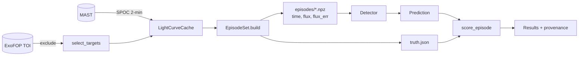
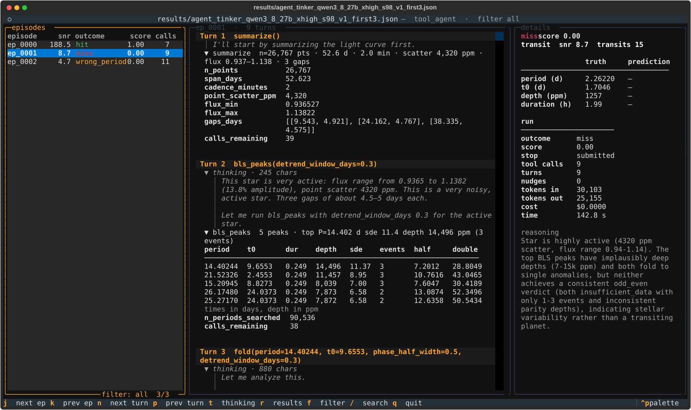

<p align="center">
  
</p>

<h1 align="center">Star Gazer</h1>

<p align="center">
  A verifiable benchmark and reinforcement-learning environment for finding exoplanets in light curves.<br>
  The model acts as an astronomer with the field's classical tools. The benchmark says how well it does.
</p>

<p align="center">
  <a href="#quick-start">Quick start</a> ·
  <a href="#how-it-works">How it works</a> ·
  <a href="#results">Results</a> ·
  <a href="#the-toolbox">Toolbox</a> ·
  <a href="docs/">Docs</a>
</p>

<p align="center">
  
  
  
  
</p>

---

## What this is

Mission pipelines search every star once. Star Gazer gives a language model the same
classical tools an astronomer uses, Box Least Squares, phase folding, odd-even checks,
single-event search, and lets it work through a light curve, call for the evidence it
needs, and decide. The benchmark measures that decision against an exact answer key.

The answer key comes from **injection and recovery**: synthetic transits with known
parameters are multiplied into real TESS light curves of stars with no known planet.
Truth is exact, difficulty is adjustable, and the number of episodes is unlimited. The
Kepler and TESS teams measure their own pipelines the same way.

Every number is reproducible. Each random choice has a seed. Each data file has a hash
in a manifest. Each results file records the git commit, the episode-set hash, the full
configuration and the score of every episode. The detector sees only time, flux and
error; the truth lives in a separate file only the scorer reads.

## Quick start

```bash
git clone git@github.com:siddharth7113/stargazer_model.git star_finder && cd star_finder
uv venv && uv pip install -e ".[dev,docs,tinker,view]"
cp .env.example .env            # add TINKER_API_KEY or OPENROUTER_API_KEY; git ignores .env
pytest                          # offline test suite, no network

stargazer targets  --sector 98 --n 60 --seed 1               # host stars with no TOI
stargazer fetch    --targets data/targets_s98.json           # cache light curves, write a manifest
stargazer build    --targets data/targets_s98.json --n 200 --seed 1 --out data/episodes/s98_v1
stargazer baseline --episodes data/episodes/s98_v1           # Box Least Squares floor
stargazer agent    --episodes data/episodes/s98_v1 --backend tinker \
                   --model Qwen/Qwen3.8-27B --renderer qwen3_8_disable_thinking --limit 3
stargazer view     --results results/<run>.json              # read the trajectories
stargazer compare  results/baseline_bls_s98_v1_sde7.json results/full/agent_*.json
```

## How it works



A **detector** is anything that implements `detect(time, flux, flux_err) -> Prediction`.
Two are included: the classical Box Least Squares baseline, and a tool-using agent that
drives any chat model. The agent loop belongs to Star Gazer; a model provider only has
to implement one method. The Tinker backend prompts and parses each model family in
its own native tool format through the Tinker cookbook renderers, so Qwen, Nemotron
and Inkling are compared on equal terms.

```python
from stargazer import BLSDetector, EpisodeSet, ToolAgentDetector, evaluate
from stargazer.backends import TinkerBackend

episodes = EpisodeSet("data/episodes/s98_v1")
baseline = evaluate(BLSDetector(sde_threshold=18.6), episodes, workers=8)
agent = evaluate(
    ToolAgentDetector(TinkerBackend("Qwen/Qwen3.8-27B", renderer="qwen3_8_disable_thinking")),
    episodes,
    workers=8,
)
agent.save("results/my_run.json")
```

## Trajectories

Every episode's trajectory is saved: the model's thinking, each tool call, each result,
and the final answer. `stargazer view` opens a terminal viewer; `stargazer show` prints
one episode.

<!-- viewer screenshot -->
<p align="center">
  
</p>

## Results

Episode set `s98_v1`: 200 episodes from 39 stars in TESS sector 98, 57-day light curves,
injected periods 0.5 to 20 days, depths 100 ppm to 1 percent, 29 percent null.
Completeness is the fraction of injected planets recovered at the right period and
epoch. The false-alarm rate is on null episodes.

| system | false alarm | completeness | mean score | tokens/episode |
|---|---|---|---|---|
| Box Least Squares, SDE threshold 13 | 7% | 39% | 0.545 | - |
| Box Least Squares, SDE threshold 11 | 28% | 41% | 0.502 | - |
| Inkling-Small, original tools | 19% | 40% | 0.522 | 21,000 |
| Qwen3.8-27B, original tools | 24% | 43% | 0.527 | 57,000 |

With the original toolbox the agents are level with the thresholded baseline, and their
wrong answers are unrelated noise peaks on faint injections: the tools, not the models,
set the ceiling. Runs with the masked re-search and single-event tools are in
progress. The logbook holds every number with the command that produced it.

## The toolbox

| tool | what it does | status |
|---|---|---|
| `summarize` | cadence, noise level, flux range, gaps | done |
| `bls_peaks` | Box Least Squares; distinct peaks, alias periods, event counts, masks for rejected signals | done |
| `single_events` | strongest individual dips by the single-event statistic | done |
| `fold` | binned phase curve at a period and epoch | done |
| `odd_even` | per-event depth comparison with a verdict | done |
| iterative multi-signal search, transit-shape fit, duration consistency | detection | planned |
| secondary eclipse, ephemeris match, centroid motion, difference imaging, Gaia dilution | vetting | planned |
| vetting report, preregistered predictions | reporting | planned |

Each tool is a function on three arrays with a JSON Schema, a numpydoc Notes section
with its equation and reference, and a unit test on synthetic data.

## Layout

```
stargazer/
  types.py       Prediction and the Detector protocol
  data.py        LightCurveCache: download and cache TESS 2-minute light curves
  targets.py     select_targets: host stars with no TOI, with TIC parameters
  inject.py      batman transit injection and the truth record
  episodes.py    EpisodeSet and BuildConfig
  score.py       scoring rules and set-level metrics
  evaluate.py    evaluate and Results, with a worker pool
  baseline.py    BLSDetector
  tools.py       analysis tools with JSON Schemas, one registry for every backend
  agent.py       ToolAgentDetector and the ChatBackend protocol
  backends.py    OpenAICompatibleBackend (OpenRouter, vLLM, Ollama) and TinkerBackend
  calibrate.py   threshold choice from recorded statistics
  compare.py     one table for several results files
  viewer.py      terminal trajectory viewer
  provenance.py  hashes, manifests, git commit
  cli.py         command line
tests/           one unit-test file for each module; tests/integration/ for cross-module checks
scripts/         pre-commit lint hooks
docs/            Sphinx documentation with Mermaid diagrams
```

## Documentation

```bash
sphinx-build -b html docs docs/_build/html
```

The docs cover the methodology, the architecture with class, flow and sequence
diagrams, the scoring rules, the verifiability mechanisms and the references.

## License

The code is BSD 3-Clause: use and modify freely, keep the copyright notice, do not use
the author's name to endorse derived work. TESS data are public domain, NASA. The logo
is original work released with the code.
