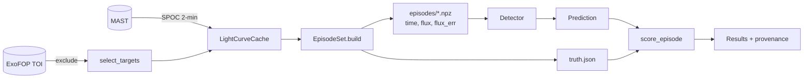

<p align="center">
  
</p>

<h1 align="center">Star Gazer</h1>

<p align="center">
  A verifiable benchmark and reinforcement-learning environment for finding exoplanets in light curves.<br>
  A language model uses the classical tools of an astronomer, and the benchmark scores its answers against an exact answer key.
</p>

<p align="center">
  <a href="#purpose">Purpose</a> ·
  <a href="#installation">Installation</a> ·
  <a href="#workflow">Workflow</a> ·
  <a href="#method">Method</a> ·
  <a href="#results">Results</a> ·
  <a href="#toolbox">Toolbox</a> ·
  <a href="https://stargazer-model.readthedocs.io/">Docs</a>
</p>

<p align="center">
  <a href="https://stargazer-model.readthedocs.io/"></a>
  
  
  
  
</p>

---

## Purpose

Mission pipelines search every star once. Star Gazer gives a language model the
classical tools of an astronomer: Box Least Squares (BLS), phase folding, odd-even
checks and single-event search. The model calls the tools it needs on one light curve
and then gives a decision. The benchmark compares that decision with an exact answer key.

The answer key comes from injection and recovery. The build step multiplies synthetic
transits with known parameters into real Transiting Exoplanet Survey Satellite (TESS)
light curves of stars with no known planet. The truth of each episode is therefore
exact. The build configuration sets the difficulty, and the number of episodes has no
limit. The Kepler and TESS teams measure their own pipelines with the same method.

Every number is reproducible. Each random choice has a seed, and a manifest holds the
hash of each data file. Each results file records the git commit, the episode-set hash,
the full configuration and the score of every episode. The detector receives only time,
flux and flux error. The truth is in a separate file that only the scorer reads.

## Installation

Clone the repository and install the package with its optional extras. Put an API key
in `.env`, then run the offline test suite.

```bash
git clone git@github.com:siddharth7113/stargazer_model.git star_finder && cd star_finder
uv venv && uv pip install -e ".[dev,docs,tinker,view]"
cp .env.example .env            # add TINKER_API_KEY or OPENROUTER_API_KEY; git ignores .env
pytest                          # offline test suite, no network
```

## Workflow

<p align="center">
  
</p>

The script `assets/quickstart.tape` defines the recording above.
[VHS](https://github.com/charmbracelet/vhs) regenerates the recording from the script,
so the recording shows the current commands.

```bash
stargazer targets  --sector 98 --n 60 --seed 1               # host stars with no TOI
stargazer fetch    --targets data/targets_s98.json           # cache light curves, write a manifest
stargazer build    --targets data/targets_s98.json --n 200 --seed 1 --out data/episodes/s98_v1
stargazer baseline --episodes data/episodes/s98_v1           # Box Least Squares floor
stargazer agent    --episodes data/episodes/s98_v1 --backend tinker \
                   --model Qwen/Qwen3.8-27B --renderer qwen3_8_disable_thinking --limit 3
stargazer view     --results results/<run>.json              # read the trajectories
stargazer compare  results/baseline_bls_s98_v1_sde7.json results/full/agent_*.json
```

## Method



A detector is any object that implements `detect(time, flux, flux_err) -> Prediction`.
The package includes two detectors: the classical BLS baseline and a tool-using agent
that drives any chat model. Star Gazer owns the agent loop, and a model provider
implements one method. The Tinker backend prompts and parses each model family in its
own native tool format through the Tinker cookbook renderers. Qwen, Nemotron and
Inkling are therefore compared on equal terms.

```python
from stargazer import BLSDetector, EpisodeSet, ToolAgentDetector, evaluate
from stargazer.backends import TinkerBackend

episodes = EpisodeSet("data/episodes/s98_v1")
baseline = evaluate(BLSDetector(sde_threshold=18.6), episodes, workers=8)
agent = evaluate(
    ToolAgentDetector(TinkerBackend("Qwen/Qwen3.8-27B", renderer="qwen3_8_disable_thinking")),
    episodes,
    workers=8,
)
agent.save("results/my_run.json")
```

## Trajectories

Star Gazer saves the trajectory of every episode. A trajectory holds the model's
thinking, each tool call, each tool result and the final answer. `stargazer view` opens
a terminal viewer, and `stargazer show` prints one episode.

<!-- viewer screenshot -->
<p align="center">
  
</p>

## Results

Episode set `s98_v1` holds 200 episodes from 39 stars in TESS sector 98. Each light
curve spans 57 days. The injected periods are 0.5 to 20 days, and the injected depths
are 100 ppm to 1 percent. Of the episodes, 29 percent are null. Completeness is the
fraction of injected planets recovered at the right period and epoch. The scorer
measures the false-alarm rate on the null episodes.

| system | false alarm | completeness | mean score | tokens/episode |
|---|---|---|---|---|
| Box Least Squares, SDE threshold 13 | 7% | 39% | 0.545 | - |
| Box Least Squares, SDE threshold 11 | 28% | 41% | 0.502 | - |
| Inkling-Small, original tools | 19% | 40% | 0.522 | 21,000 |
| Qwen3.8-27B, original tools | 24% | 43% | 0.527 | 57,000 |

With the original toolbox, the agents score level with the thresholded baseline. Their
wrong answers are unrelated noise peaks on faint injections, so the toolbox sets the
ceiling. The choice of model does not set it. Runs with the masked re-search and
single-event tools are in progress. LOGBOOK.md holds every number with the command
that produced it.

## Toolbox

| tool | what it does | status |
|---|---|---|
| `summarize` | cadence, noise level, flux range, gaps | done |
| `bls_peaks` | Box Least Squares; distinct peaks, alias periods, event counts, masks for rejected signals | done |
| `single_events` | strongest individual dips by the single-event statistic | done |
| `fold` | binned phase curve at a period and epoch | done |
| `odd_even` | per-event depth comparison with a verdict | done |
| iterative multi-signal search, transit-shape fit, duration consistency | detection | planned |
| secondary eclipse, ephemeris match, centroid motion, difference imaging, Gaia dilution | vetting | planned |
| vetting report, preregistered predictions | reporting | planned |

Each tool is a function of three arrays. Each tool has a JSON Schema, a numpydoc Notes
section with its equation and reference, and a unit test on synthetic data.

## Layout

```
stargazer/
  types.py       Prediction and the Detector protocol
  data.py        LightCurveCache: download and cache TESS 2-minute light curves
  targets.py     select_targets: host stars with no TOI, with TIC parameters
  inject.py      batman transit injection and the truth record
  episodes.py    EpisodeSet and BuildConfig
  score.py       scoring rules and set-level metrics
  evaluate.py    evaluate and Results, with a worker pool
  baseline.py    BLSDetector
  tools.py       analysis tools with JSON Schemas, one registry for every backend
  agent.py       ToolAgentDetector and the ChatBackend protocol
  backends.py    OpenAICompatibleBackend (OpenRouter, vLLM, Ollama) and TinkerBackend
  calibrate.py   threshold choice from recorded statistics
  compare.py     one table for several results files
  viewer.py      terminal trajectory viewer
  provenance.py  hashes, manifests, git commit
  cli.py         command line
tests/           one unit-test file for each module; tests/integration/ for cross-module checks
scripts/         pre-commit lint hooks
docs/            Sphinx documentation with Mermaid diagrams
```

## Documentation

The documentation is on Read the Docs at
<https://stargazer-model.readthedocs.io/>. Each push to `main` rebuilds it. To build it
locally:

```bash
sphinx-build -b html docs docs/_build/html
```

The documentation covers the methodology, the architecture with class, flow and
sequence diagrams, the scoring rules, the verifiability mechanisms and the references.

## License

The code has the BSD 3-Clause license. The license permits use and modification. It
requires the copyright notice in each copy and forbids use of the author's name to
endorse derived work. The TESS data are NASA data in the public domain. The logo is
original work released with the code.
