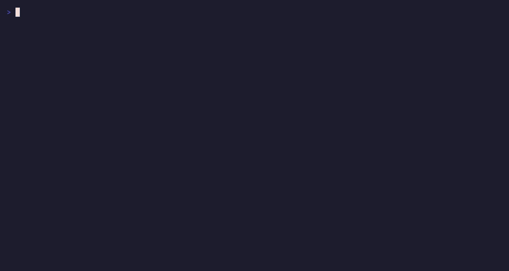
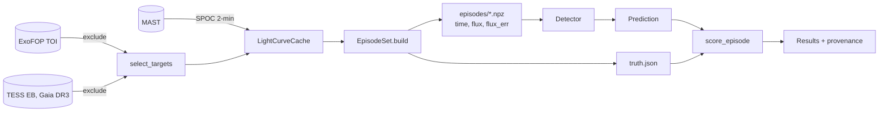

<p align="center">
  
</p>

<h1 align="center">Star Gazer</h1>

<p align="center">
  A benchmark and reinforcement-learning environment for exoplanet detection in TESS light curves.
</p>

<p align="center">
  <a href="#purpose">Purpose</a> ·
  <a href="#installation">Installation</a> ·
  <a href="#workflow">Workflow</a> ·
  <a href="#method">Method</a> ·
  <a href="#results">Results</a> ·
  <a href="#toolbox">Toolbox</a> ·
  <a href="https://stargazer-model.readthedocs.io/">Docs</a>
</p>

<p align="center">
  <a href="https://stargazer-model.readthedocs.io/"></a>
  
  
  
  
</p>

---

## Purpose

Star Gazer is a Python package for measuring how well a language model finds
transiting planets in light curves. The model is given one light curve and a set of
analysis tools (Box Least Squares, phase folding, an odd-even depth check, a
single-event search), calls them as it sees fit, and reports whether it found a
transit and at what period and epoch. The package scores the report, runs the
classical Box Least Squares pipeline on the same data for comparison, and saves the
full record of each run.

The test data are made by injection and recovery, the standard method for measuring
the completeness of a transit survey. Synthetic transits with known parameters are
multiplied into real TESS light curves of stars with no detected planet, and a fraction
of the light curves is left untouched. The truth for each episode is therefore known
exactly, and the difficulty of a set is chosen when it is built.

Each episode set has a manifest with the hash of every file, and each results file
records the git commit, the hash of the episode set, the detector configuration and
the score of every episode. The truth file is kept apart from the episode files and is
read only by the scorer.

The documentation is at <https://stargazer-model.readthedocs.io/>. PLAN.md holds the
roadmap and LOGBOOK.md holds every run made so far, with the command that produced it.

## Installation

Star Gazer requires Python 3.13. Clone the repository and install it in editable mode
with the optional extras for development, documentation, the Tinker backend and the
trajectory viewer. The agent commands read API keys from a `.env` file in the project
root, which git ignores. The test suite runs without network access.

```bash
git clone git@github.com:siddharth7113/stargazer_model.git star_finder && cd star_finder
uv venv && uv pip install -e ".[dev,docs,tinker,view]"
cp .env.example .env            # add TINKER_API_KEY or OPENROUTER_API_KEY; git ignores .env
pytest                          # offline test suite, no network
```

## Workflow

<p align="center">
  
</p>

The commands below build an episode set from one TESS sector, run the baseline and a
language-model agent on it, and compare the two. The recording was made with
[VHS](https://github.com/charmbracelet/vhs) from `assets/quickstart.tape`.

```bash
stargazer targets  --sector 98 --n 60 --seed 1               # host stars with no TOI
stargazer fetch    --targets data/targets_s98.json           # cache light curves, write a manifest
stargazer build    --targets data/targets_s98.json --n 200 --seed 1 --out data/episodes/s98_v1
stargazer baseline --episodes data/episodes/s98_v1           # Box Least Squares floor
stargazer agent    --episodes data/episodes/s98_v1 --backend tinker \
                   --model Qwen/Qwen3.8-27B --renderer qwen3_8_disable_thinking --limit 3
stargazer view     --results results/<run>.json              # read the trajectories
stargazer compare  results/baseline_bls_s98_v1_sde7.json results/full/agent_*.json
```

## Method



A detector is any object with a `detect(time, flux, flux_err) -> Prediction` method.
The package provides two: `BLSDetector`, the classical Box Least Squares pipeline with a
signal detection efficiency threshold, and `ToolAgentDetector`, which runs a chat model
in a loop with the analysis tools until the model submits a prediction. The agent loop,
the tools and the prompt are part of the package; a backend only has to turn a list of
messages into one assistant turn. Two backends are included, one for OpenAI-compatible
servers such as OpenRouter and one for Tinker. The Tinker backend formats prompts and
parses tool calls with the Tinker cookbook renderers, so each model family is used in
its own tool-calling format.

```python
from stargazer import BLSDetector, EpisodeSet, ToolAgentDetector, evaluate
from stargazer.backends import TinkerBackend

episodes = EpisodeSet("data/episodes/s98_v1")
baseline = evaluate(BLSDetector(sde_threshold=18.6), episodes, workers=8)
agent = evaluate(
    ToolAgentDetector(TinkerBackend("Qwen/Qwen3.8-27B", renderer="qwen3_8_disable_thinking")),
    episodes,
    workers=8,
)
agent.save("results/my_run.json")
```

## Trajectories

The results file of an agent run holds the complete trajectory of every episode: the
model's reasoning where the backend exposes it, each tool call with its arguments, each
tool result and the final submission. `stargazer view` opens the file in a terminal
viewer, and `stargazer show` prints one episode.

<!-- viewer screenshot -->
<p align="center">
  
</p>

## Course notebooks

The `examples/` directory holds notebooks for a human reader, one for each part of
the toolbox, with a plot for each result. They are built and executed by
`scripts/build_notebooks.py`, so a change to a tool is a change there. Each notebook
runs on the real episode set if `data/episodes/s98_v2` is present and on a synthetic
light curve otherwise. Install the `notebooks` extra to run them.

## Results

Episode set `s98_v1` has 200 episodes from 39 stars observed in TESS sector 98. The
light curves are 57 days long; the injected periods run from 0.5 to 20 days and the
depths from 100 ppm to 1 percent; 29 percent of the episodes have no injected transit.
Completeness is the fraction of injected transits recovered at the correct period and
epoch. The false-alarm rate is the fraction of episodes without a transit on which a
detection was reported.

| system | false alarm | completeness | mean score | tokens/episode |
|---|---|---|---|---|
| Box Least Squares, SDE threshold 13 | 7% | 39% | 0.545 | - |
| Box Least Squares, SDE threshold 11 | 28% | 41% | 0.502 | - |
| Inkling-Small, original tools | 19% | 40% | 0.522 | 21,000 |
| Qwen3.8-27B, original tools | 24% | 43% | 0.527 | 57,000 |

With this set of tools the two agents are about level with the thresholded baseline.
Most of their wrong periods are noise peaks on faint injections, which the Box Least
Squares tool returned as the top result and the model had no tool to reject.

Episode set `s98_v2` is built on the same stars with periods from 0.5 to 60 days, so
single and double transits are common: 18 of its 127 injections with a transit in
the data have one. The table follows Inkling-Small through the toolbox on this set.
Each row adds the tools and prompt rules named; LOGBOOK.md has the command, the
cost and the reading of each run.

| toolbox | false alarm | completeness | with aliases and events | mean score | one-transit hits |
|---|---|---|---|---|---|
| Box Least Squares at 5 percent false alarm | 5% | 25% | - | - | 0 of 18 |
| masked re-search, single events | 11% | 32% | 34% | 0.533 | 0 of 18 |
| single-event submission form, edge guard | 12% | 28% | 34% | 0.515 | 2 of 18 |
| search_signals, single-event rules | 11% | 32% | 35% | 0.538 | 2 of 18 |
| fit_transit, secondary_eclipse | 3% | 35% | 37% | 0.583 | 1 of 18 |
| event count by points in transit | 5% | 33% | 35% | 0.558 | 3 of 18 |
| the same tools, base prompt (no procedure, no rules) | 40% | 39% | 43% | 0.476 | 5 of 18 |

The two vetting tools cut the false-alarm rate to 3 percent and the wrong periods
from 10 to 4. The event count by points in transit returned the lone transits to the
single-event form. The last row uses a system prompt that states the task, the
scoring and the units and nothing else: the model finds more and submits seven
times as many false alarms. The difference between the two prompts is the policy
that the reinforcement-learning phase has to learn.

Three of the 39 hosts are in the TESS eclipsing-binary catalogue, and their own
eclipses were the deepest false alarms of the series. Episode set `s98_v3` is built
on the 36 other stars with the same ranges, and host selection now excludes known
eclipsing binaries as it excludes TOI hosts. The seed comparisons of the next phase
run on `s98_v3`; the table above stays as the record of the toolbox on `s98_v2`.

On `s98_v3`, Inkling-Small ran three times with each prompt, each run with its own
sampling seed, so the table gives the mean over seeds and, in brackets, the standard
deviation. The spread is the yardstick: a change counts when it moves a number by
more than the spread. BLS on this set finds 34 percent at a 5 percent false-alarm
rate, and no single transit.

| system, s98_v3 | false alarm | completeness | with aliases | mean score | one-transit hits |
|---|---|---|---|---|---|
| Box Least Squares at 5 percent false alarm | 5% | 34% | 34% | - | 0 of 17 |
| Inkling-Small, rules prompt, 3 seeds | 2% (2) | 39% (1) | 41% (1) | 0.573 (0.000) | 3 of 17 |
| Inkling-Small, base prompt, 3 seeds | 31% (5) | 40% (3) | 42% (2) | 0.492 (0.034) | 3 of 17 |
| Inkling, rules prompt, 3 seeds | 16% (6) | 43% (1) | 45% (0) | 0.558 (0.015) | 2 of 17 |
| Qwen3.5-397B-A17B, rules prompt, 3 seeds | 15% (4) | 43% (1) | 44% (1) | 0.558 (0.006) | 2 of 17 |
| Kimi K2.6, rules prompt, 3 seeds | 14% (5) | 42% (1) | 43% (0) | 0.552 (0.018) | 2 of 17 |
| Nemotron 3 Ultra, rules prompt, 3 seeds | 7% (3) | 37% (2) | 39% (2) | 0.543 (0.021) | 3 of 17 |
| Kimi K2.6, base prompt, 3 seeds | 21% (1) | 45% (1) | 45% (1) | 0.548 (0.009) | 2 of 17 |
| Qwen3.5-397B-A17B, base prompt, 3 seeds | 29% (5) | 40% (1) | 43% (0) | 0.498 (0.014) | 2 of 17 |
| Inkling, base prompt, 3 seeds | 40% (4) | 43% (1) | 44% (1) | 0.482 (0.018) | 1 of 17 |
| Nemotron 3 Ultra, base prompt, 3 seeds | 27% (4) | 37% (2) | 39% (2) | 0.482 (0.004) | 4 of 17 |

The large models ran through the Tinker sampling API with the thinking renderer of
each family (`results/full_v9large/`, 30 runs). With the rules prompt the five
models land between 0.54 and 0.57, within one or two seed spreads of each other, and
the small model is at the top; Kimi K2.6, the best model with the base prompt, gains
nothing from the procedure. The ceiling is set by the toolbox. The false alarms under
the rules are the same stars for every model: 83 of the 90 in the twelve large-model
rules runs sit on nine null hosts, with periods of one or two TESS orbits (14 to 17
and 28 days) or a short-period variable star (a 0.946-day pulsator on TIC 55270064,
a 1.38-day signal on TIC 32816814). The LOGBOOK entries of 2026-10-25 have the
per-seed numbers and the reading.

A held-out set, `s92_v1`, holds 200 episodes on 28 other stars from sector 92, built
with the same settings. No tool or prompt is designed on it; it confirms a change that
`s98_v3` showed. Inkling-Small at one seed gives 7 percent false alarms and 36 percent
completeness with the rules prompt and 31 and 38 percent with the base prompt, against
BLS at 32 percent completeness for 5 percent false alarms, the same picture as on
`s98_v3` (LOGBOOK 2026-10-25).

## Toolbox

| tool | what it does | status |
|---|---|---|
| `summarize` | cadence, noise level, flux range, gaps | done |
| `bls_peaks` | Box Least Squares; distinct peaks, alias periods, event counts, masks for rejected signals | done |
| `search_signals` | search, mask the strongest signal, search again, until the rest is noise | done |
| `single_events` | strongest individual dips by the single-event statistic, with the noise at each timescale | done |
| `fold` | binned phase curve at a period and epoch | done |
| `orbit_shape` | the whole orbit at a period: flat, or variable at that period as a pulsating or rotating star is | done; no gain on Inkling-Small, kept for the large-model pass |
| `fit_transit` | batman fit: depth, duration, impact parameter, host density and shape verdicts | done |
| `odd_even` | per-event depth comparison with a verdict | done |
| `secondary_eclipse` | second dip at phase 0.5 or any other phase, with a verdict | done |
| `ephemeris_match` | the candidate against the star's TOI and eclipsing-binary entries and its Gaia class, with a verdict | done |
| `nearby_stars` | Gaia sources within two pixels, their flux fraction and the depth each could make, with a verdict | done |
| centroid motion, difference imaging | vetting, needs the pixel data | planned |
| vetting report, preregistered predictions | reporting | planned |

Each tool is a function of the time, flux and flux-error arrays. It has a JSON Schema
that the model sees, a numpydoc docstring with the equation and a reference, and a
unit test on synthetic data.

## Documentation

The documentation is built with Sphinx from the `docs/` directory and published at
<https://stargazer-model.readthedocs.io/> on each push to `main`. It covers the
method, the architecture, the scoring rules, the provenance records and the
references. To build it locally:

```bash
sphinx-build -b html docs docs/_build/html
```

## License

Star Gazer is distributed under the 3-Clause BSD license; see the LICENSE file. The
TESS light curves are NASA data in the public domain. The logo is original work
released with the code.
